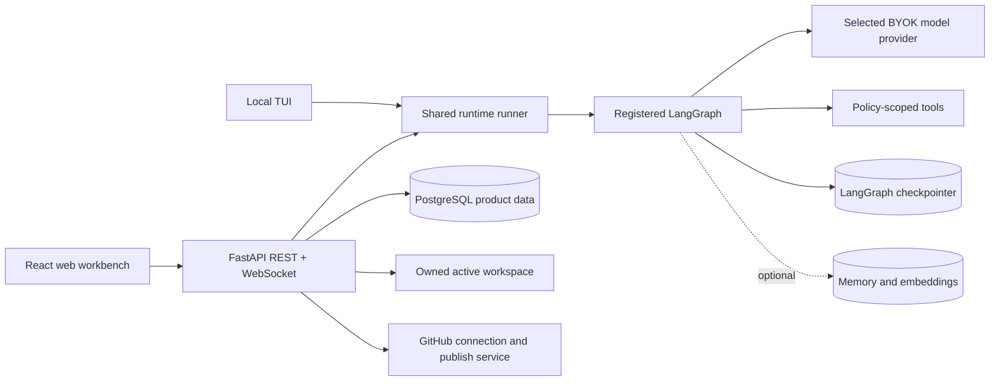

# Compass architecture

This document describes code that is registered and exercised in the current repository. Future work is isolated in [roadmap.md](../roadmap.md).

## System boundary

The TUI and web workbench share `agent.runtime.runner`, event types, interrupt protocol, and the registered graph. They do not share the same authority. The TUI targets the current repository and can request local shell/file side effects. The hosted web target is restricted to an owned server workspace and removes shell execution in cloud mode.

## One executor spine

The graph has one main `executor` mutation spine. Routing can take a smaller path for short read-only chat, but planning, tools, recovery, linting, evaluation, compaction, and verification return to or finish from that main spine. Skills use scoped registries; optional coordinator workers do not become independent mutating executors.

The complete registered node/edge view is generated from the `StateGraph` builder in [langgraph_workflow.md](../langgraph_workflow.md). `tools/render_workflow.py` imports registration only: it does not compile the graph, connect to a model or database, or invoke a tool.

### Turn sequence

1. The surface builds a fresh turn payload and normalizes mode names.
2. The runtime validates explicit context files against the configured workspace.
3. Turn context loads bounded project rules, tools, skills, model/provider settings, and workspace metadata.
4. The graph chooses direct chat, planning, skill, or executor entry based on the request and mode.
5. Tool calls pass through the safety node. File mutations create checkpoints before execution.
6. Goal work can run deterministic lint/evaluation/recovery and loop/goal limits.
7. Changed files can schedule configured verification hooks through the same approval boundary.
8. The shared runner emits canonical events and a run artifact to the TUI or web persistence layer.

## Explicit interrupts

Compass uses typed LangGraph interrupts for three cases:

| Interrupt | Resume actions | Effect |
| --- | --- | --- |
| Plan approval | execute, revise with feedback, cancel | Execution does not silently pass the plan gate. |
| Tool approval | approve, always for the allowed local operation, deny, skip | Denied/skipped calls return to the executor; verification hooks always ask. |
| Clarification | answer with feedback | The exact answer is returned to the graph as user clarification. |

The shared runtime projects an interrupt into an approval/clarification event followed by a waiting event. Web runs persist that waiting state and resume through a typed `Command`; the TUI uses the same action vocabulary.

## Active workspace and ownership

Each web session points to one explicit `active_workspace_id`. A newer failed or unrelated workspace is not substituted. Before an agent run, the backend loads a short database transaction and detaches a `RunContextSnapshot` containing user, session/thread, active workspace path, project identity, context versions, preferences, and Git metadata.

Workspace APIs enforce ownership and descendant paths. Turn context rejects absolute paths and `..` traversal. If the session and workspace context versions disagree, the run returns a context-mismatch failure instead of using stale project evidence.

The TUI uses a local `WorkspaceContext` for the selected repository. Local session forks share that working directory; web workspace ownership remains per user/session.

## Rules, hooks, and checkpoints

### Project rules

At each turn Compass discovers regular UTF-8 rule files from the user and workspace: global `COMPASS.md`, then workspace `AGENTS.md`, `CLAUDE.md`, `GEMINI.md`, and `COMPASS.md` in defined precedence. Rendering is bounded to 20,000 characters and keeps higher-precedence rules when truncation is necessary. Rule digests and inclusion metadata are safe to inspect; arbitrary nested rule discovery is not claimed.

### Verification hooks

Post-edit hooks come from the project `.compass/config.toml`. The loader validates names, command arrays, relative working directories, run modes, and timeouts. Hooks are inspection-only until scheduled by a changed-file result, then execute through the shell tool only after explicit approval. Their started/passed/failed status is projected into run events.

### File checkpoints

Mutating file tools create recoverable workspace checkpoints. Checkpoints carry workspace/thread identity and file digests; restore previews expose conflicts before replacement. TUI commands and owned web endpoints list, preview, and restore them. These file checkpoints are distinct from LangGraph conversation checkpoints.

## Bounded read-only workers

Planning may opt into orchestration only when the typed dependency graph contains at least two independent ready tasks and orchestration is enabled. The coordinator caps workers according to configuration. Each worker receives only registry-approved read tools, cannot edit, approve, delegate, create skills, or spawn another coordinator, and must return a structured artifact with evidence. Timeout, cancellation, invalid artifacts, dependency failures, and synthesis conflicts are surfaced.

`synthesis` merges worker evidence and proposed text suggestions, then returns to the single executor. Workers never bypass the executor or safety node for changes.

## Metrics and events

Run metrics are request-scoped through a context variable. They aggregate span calls/errors/duration, model calls and tokens per node, total tokens, a model-dependent estimated cost when known, and a small allowlist of safe tags. Prompts, tool arguments, credentials, and raw file contents are not metric tags.

The shared stream protocol includes status, tokens, tool calls/results, approvals, clarification, plan/check steps, worker lifecycle, patches, checkpoints, errors, cancellation, and completion. The web stores sequenced run events and the TUI renders the same event models locally.

## Persistence

| State | Current store | Notes |
| --- | --- | --- |
| Users, sessions, messages, runs/events, workspaces, patches, uploads, preferences | PostgreSQL | Web product state with ownership checks. |
| Agent thread state | LangGraph PostgreSQL checkpointer for web | Required by web readiness; local TUI may use the fallback without `DB_URI`. |
| Workspace files | Private filesystem root | Per-user web descendants or the selected local repository. |
| File recovery checkpoints | Workspace `.compass` data | Preview/restore is ownership- and conflict-aware. |
| Long-term memory | Lazy PostgreSQL store | Optional capability; project/global namespaces include user identity. |
| Semantic retrieval | PostgreSQL vector support and configured embeddings | Unavailable when embedding configuration/credentials are absent. |
| Local settings | User/project TOML | Layered settings with registered consumers. |

Session deletion is soft deletion. Active runs and sockets are stopped first, but physical workspace, upload, vector, checkpoint, and database retention is an operator concern.

## Web API composition

FastAPI mounts product routers under `/api` for authentication, sessions/runs/uploads, chat, settings, skills, workspaces/patches/checkpoints, tools, GitHub, and memory. `/health` and `/ready` remain outside the product prefix.

The browser uses the same `/api` base for HTTP and derives `/api/chat/ws/<session-id>` for WebSocket. It sends the access token through WebSocket subprotocols. Access tokens stay in memory; refresh uses a rotating, single-use HttpOnly cookie scoped to `/api/auth`.

## Operational constraints

- One backend process only. HTTP, WebSocket, active-run, and run-start limits are process-local.
- Required readiness: database, durable checkpointer, writable workspace root.
- Optional readiness: memory store, embeddings, MCP.
- Cloud startup rejects a weak/default JWT secret, a missing or shared credential-encryption key, and insecure cookies.
- Web skill writes are isolated per user; global installed skills are read-only.
- Hosted mode does not accept arbitrary local shell or command MCP configuration.
- Soft deletion does not imply physical erasure.

## Verification boundary

`tools/verify.py` orchestrates deterministic Python, frontend, Compose, documentation, and migration-head checks with explicit argument arrays, working directories, and timeouts. It does not start models, provision infrastructure, or replace manual end-to-end TUI/web journeys.
