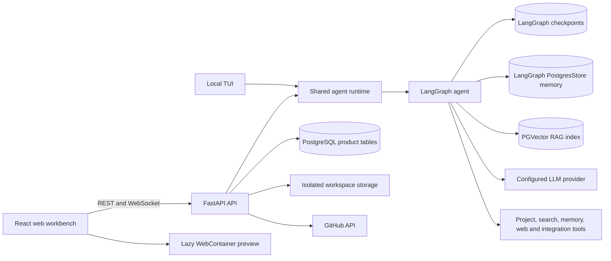
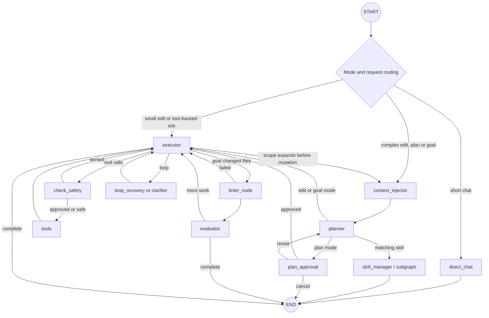

# Compass architecture and feature reference

This document is the developer map for Compass. It describes the active web and TUI product, the LangGraph workflow, long-term memory, API routers, persistence tables, frontend surfaces, safety boundaries, and the intended extension points.

## 1. Product definition

Compass is a web coding workbench and local terminal agent. Its target is Codex-style project work at the feature level: chat, code understanding, controlled edits, patch review, project preview, project download, reusable skills and subagents, durable memory, RAG, MCP, and GitHub publishing.

The web product and TUI share the agent but have different execution boundaries:

| Surface | Project boundary | Shell | MCP | Change behavior |
| --- | --- | --- | --- | --- |
| Web workbench | Server-managed isolated workspace | Disabled | Server-managed capabilities only | Agent writes become reviewable workspace patches |
| Local TUI | User-selected local repository | Available with approval policy | Local command MCP allowed | Shared runtime with local diff and undo controls |

The VS Code extension is intentionally outside the active product architecture for now. Its source remains in the repository, but web and TUI development must not depend on it.

## 2. Design rules

1. Normal conversation uses the shortest possible path: one chat node and no project tools.
2. Expensive features load only when their branch needs them.
3. Thread history and durable user memory are separate concerns.
4. All web data is scoped by authenticated user ownership.
5. Risky tool calls pass through deterministic approval; prompts are an additional behavioral layer, not the security boundary.
6. Agent changes are inspectable as patches before publishing.
7. Public API URLs remain stable even when internal modules are reorganized.
8. Web, TUI and automation consume one canonical agent runtime and event protocol.

## 3. System overview



## 4. LangGraph workflow

### Modes

| Mode | Entry branch | Purpose | Validation |
| --- | --- | --- | --- |
| Ask | Direct chat for short questions; read-only executor when project tools are needed | Explain and inspect | No mutation tools |
| Edit | Executor for bounded changes; planner for complex or expanded scope | Make project changes without sacrificing complex-task quality | Tool safety and patch review |
| Plan | Context → planner → plan approval | Produce and approve a plan before execution | Human plan approval |
| Goal | Context → planner → executor | Autonomous multi-step goal | Syntax checks, evaluator and loop recovery |
| Skill | Planner-selected ephemeral subgraph | Run specialized instructions/tools | Inherits parent config and tool approval |

### Active graph



Important implementation points:

- NeMo Guardrails is not part of the graph.
- The input/output safety behavior is in system policy, while actual mutation control is in `check_safety_node` and workspace boundaries.
- New turns reset plan, tool, loop, syntax, and approval state so previous work cannot hijack routing.
- Only `direct_chat`, `executor`, `skill_manager`, and nested `sub_executor` output is sent as assistant tokens.
- Planner and evaluator output is represented as structured status/plan events, not mixed into the answer.
- Web and TUI consume the same `agent/runtime` events for tokens, tools, plans, approvals, cancellation, errors and completion.
- Skills use per-invocation subgraphs and inherit user, project, provider, model, run, workspace, and approval context.

## 5. Memory architecture

Compass uses the two LangGraph memory layers for different jobs.

### Short-term thread memory

- Backing technology: `AsyncPostgresSaver` when `DB_URI` is available.
- Key: the chat session's LangGraph `thread_id`.
- Contents: graph state and conversation messages required to resume or interrupt a thread.
- Initialization: warmed during FastAPI startup; connection waits are bounded and fall back rather than blocking a request indefinitely.

### Long-term memory

- Backing technology: LangGraph `PostgresStore` with an optional pgvector semantic index.
- Graph integration: a lazy `BaseStore` proxy is attached at graph compilation.
- Initialization: the Store and embedding client are created only on first memory use.
- Recall: enabled global and active-project memories are injected for executor turns; the greeting/direct-chat path does not initialize memory.
- Editing: authenticated CRUD at `/api/memory` and the frontend Settings → Memory surface.

Namespaces are isolated as follows:

```text
("users", user_id, "memory", "global")
("users", user_id, "memory", "projects", project_id)
```

Each memory document contains:

| Field | Meaning |
| --- | --- |
| `key` | Stable identifier |
| `content` | Recallable fact or preference |
| `category` | User-facing grouping |
| `scope` | `global` or `project` |
| `project_id` | Project identity for project scope |
| `enabled` | Whether the agent may recall it |
| `created_at`, `updated_at` | Audit timestamps |

The legacy `/api/tools/memory` endpoint remains read-compatible for the Context Drawer. New writes use `/api/memory`.

## 6. Feature inventory

| Feature | Web | TUI | Main implementation |
| --- | --- | --- | --- |
| Streaming chat | Yes | Yes | `backend/routers/chat.py`, `agent/ui/tui.py` |
| Ask/Edit/Plan/Goal | Yes | Yes | `agent/graph/workflow.py` |
| Project file browsing/editing | Yes | Yes | workspace routers and file tools |
| Patch review/apply/reject/undo | Yes | Yes | `patch_manager.py`, changes UI, TUI diffs |
| ZIP download | Yes | Local filesystem already available | `GET /api/workspaces/{id}/download` |
| Web preview | Yes, lazy WebContainer | External/local tools | `WebPreview.tsx` |
| GitHub import/branch/commit/PR | Yes | Yes | GitHub router/service and TUI helpers |
| RAG/codebase search | Yes | Yes | `agent/rag`, PGVector, search tools |
| Uploaded document context | Yes | Yes | uploads router and RAG ingestion |
| Skills manager | Yes | Yes | skills router, registry and Settings UI |
| Skill subagents | Yes | Yes | `SubAgentFactory`, `SkillManagerAgent` |
| Long-term memory editing | Yes | Tool/commands | LangGraph Store and `MemoryManager.tsx` |
| MCP | Managed only | Local command MCP | `agent/mcp.py`, settings policy |
| Risky tool approval | Yes | Yes | `agent/safety.py`, LangGraph interrupt |
| Run timeline/history | Yes | Console status | runs router and `RunContext` |
| Cooperative cancellation | Yes | Ctrl+C | cancel endpoint and run signals |
| Themes/responsive workbench | Yes | TUI theme | frontend contexts/components |

## 7. Backend router inventory

Every HTTP route below is mounted beneath `/api`. WebSocket chat is also mounted beneath `/api`.

### `auth.py` — `/auth`

- `POST /register`
- `POST /login`
- `POST /refresh`
- `GET /me`
- `POST /logout`
- `GET /oauth/google/url`
- `GET /oauth/github/url`
- `POST /oauth/google`
- `POST /oauth/github`

Responsibilities: password/OAuth identity, access and refresh tokens, browser-safe user response.

### `sessions.py` — `/sessions`

- `GET /`
- `POST /`
- `GET /{session_id}`
- `PATCH /{session_id}`
- `DELETE /{session_id}`

Responsibilities: task/session lifecycle, titles, soft deletion, messages and LangGraph thread identity.

### `chat.py` — `/chat`

- `POST /send` — non-streaming fallback
- `WS /ws/{session_id}` — primary streaming agent channel

Responsibilities: ownership check, message persistence, local agent run creation, WebSocket events, final assistant persistence and auto-title.

### `settings.py` — `/settings`

- `GET /`
- `PUT /`
- `GET /mcp-servers`
- `POST /mcp-servers`
- `POST /mcp-servers/test`

Responsibilities: user model/theme/safety preferences and the hosted MCP boundary. Command-based MCP mutations are rejected in the hosted product.

### `runs.py` — `/sessions/{session_id}/runs`

- `GET /`
- `POST /{run_id}/cancel`

Responsibilities: run/event history and cooperative cancellation.

### `skills.py` — `/skills`

- `GET /`
- `POST /`
- `DELETE /{skill_name}`

Responsibilities: validated skill names, `SKILL.md` authoring, registry reload, and skill metadata.

### `memory.py` — `/memory`

- `GET /`
- `POST /`
- `PUT /{memory_key}`
- `DELETE /{memory_key}`

Responsibilities: authenticated global/project LangGraph Store memory CRUD.

### `tools.py` — `/tools`

- `GET /` — tool catalog and web/TUI availability
- `GET /tasks` — compatibility task list
- `GET /memory` — compatibility global memory view

### `uploads.py` — `/sessions/{session_id}/uploads`

- `GET /capabilities`
- `GET /`
- `POST /`
- `DELETE /{upload_id}`

Responsibilities: safe upload metadata, storage, validation and RAG ingestion.

### `workspaces.py` — `/workspaces`

- `POST /{session_id}/upload`
- `GET /{workspace_id}/tree`
- `GET /{workspace_id}/file`
- `GET /{workspace_id}/download`
- `GET /{workspace_id}/export-json`
- `POST /{workspace_id}/file`
- `PUT /{workspace_id}/file`
- `DELETE /{workspace_id}/file`
- `POST /{workspace_id}/rename`
- `GET /`
- `GET /{workspace_id}/context`
- `POST /{workspace_id}/context/refresh`
- `GET /{workspace_id}/search`
- `POST /create`
- `GET /{workspace_id}/patches`
- `POST /{workspace_id}/patches/{patch_id}/apply`
- `POST /{workspace_id}/patches/{patch_id}/reject`
- `POST /{workspace_id}/patches/{patch_id}/files/{action}`
- `POST /{workspace_id}/patches/accept-all`
- `POST /{workspace_id}/patches/reject-all`
- `POST /{workspace_id}/patches/{patch_id}/undo`

Responsibilities: project storage and identity, browsing, direct file operations, archive download, WebContainer export, context versions, search and patch review.

### `github.py` — `/github`

- `GET /status`
- `GET /oauth/url`
- `POST /oauth/exchange`
- `POST /connections/pat`
- `POST /connection/validate`
- `DELETE /connection`
- `GET /repositories`
- `GET /repositories/{owner}/{repo}/branches`
- `POST /import`
- `POST /branches` and compatibility `/publish/branch`
- `POST /commit` and compatibility `/publish/commit`
- `POST /pull-requests` and compatibility `/publish/pull-request`

Responsibilities: encrypted GitHub connection, repository discovery/import, branch creation, reviewed commit and pull request publishing.

## 8. Product database tables

These tables are owned by SQLAlchemy/Alembic.

### `users`

Identity and preferences. Key fields: `id`, unique `email`, password/OAuth identity, encrypted OAuth token/scopes, profile fields, `is_active`, JSON `preferences`, timestamps.

Relationships: one user has sessions, uploads and workspaces.

### `chat_sessions`

A user-owned task/conversation. Key fields: `id`, `user_id`, `title`, unique LangGraph `thread_id`, project/git/context identity, soft-delete flag, timestamps.

Relationships: messages, uploads, workspaces and runs cascade with the session.

### `messages`

Persisted transcript entries. Key fields: `session_id`, `role`, `content`, serialized `tool_calls`, `tool_call_id`, `model`, `token_count`, `created_at`.

### `workspaces`

The physical web project boundary. Key fields: `user_id`, `session_id`, `storage_path`, `source_type`, `status`, project/git/context identity, file count, size and timestamps.

### `uploaded_files`

Uploaded context metadata. Key fields: owner/session, name/type/size/path, processing status/error, RAG chunk count and timestamp.

### `agent_runs`

One graph execution. Key fields: session/workspace/project/context identity, `status`, start/end time and JSON token usage.

Status progression includes `running`, `cancelling`, `cancelled`, `completed`, and `error`.

### `run_events`

Structured non-token run events. Key fields: `run_id`, event type, JSON content and timestamp. Token chunks are deliberately not stored individually; this avoids one transaction per generated token.

### `workspace_patches`

Reviewable agent changes. Key fields: workspace/run/project/context identity, status, JSON changes, creation/application timestamps. Status values are `pending`, `applied`, `rejected`, and `reverted`.

### Library-managed PostgreSQL data

LangGraph creates and manages checkpoint tables for thread state. LangGraph PostgresStore creates and manages long-term memory storage/index tables. PGVector manages semantic RAG collections/embeddings. These schemas must be changed through their owning library setup/migrations, not through the product ORM models.

## 9. Frontend architecture

### State boundaries

| Context/hook | Owns |
| --- | --- |
| `AuthContext` | Browser identity and token invalidation |
| `WorkbenchContext` | Active workspace, file, panels, mode, patch counts and refresh versions |
| `RunContext` | Active run stages, connection state and latency metrics |
| `useSessions` | Session list and active task |
| `useWorkspaceTree` | Project tree and refresh behavior |

### Main surfaces

- `ChatPage`: task transcript, stream lifecycle, approvals, cancellation and responsive composition.
- `AgentPanel`: messages, composer, plan review and run activity.
- `CenterWorkbench`: file tree, CodeMirror editor, changes and preview. It is dynamically loaded only when a workspace is open.
- `ContextDrawer`: selected files, tasks and read-compatible memory context.
- `SettingsModal`: account, model, appearance, memory and advanced skill/MCP controls.
- `MemoryManager`: global/project memory create, edit, enable/disable and delete.
- `WebPreview`: dynamically imports WebContainer and starts preview only on demand.

Streaming tokens are buffered for roughly one animation frame before updating React state, preventing full Markdown/code rendering on every network chunk. The WebSocket closes on `done`/`error`. Workspace refreshes occur on actual workspace patch events instead of every chat completion.

## 10. Repository map

```text
agent/
  graph/       state, nodes, routing and tool execution
  runtime/     shared turn input, streaming events, approvals and cancellation
  skills/      skill loader, registry, manager and ephemeral subgraphs
  tools/       project/search/web/memory/todo tool implementations
  rag/         loading, chunking, indexing and PGVector retrieval
  ui/          local terminal interface
  llm.py       role-based model factory and optional cache
  safety.py    deterministic tool approval policy
  workspace.py execution and project identity boundaries

backend/
  routers/     one router per product capability
  services/    orchestration and domain operations
  models/      SQLAlchemy product tables
  schemas/     HTTP/WebSocket DTOs
  auth/        passwords, OAuth, JWT and credential encryption
  ws/          connection hub and heartbeat
  alembic/     product database migrations

frontend/src/
  api/         typed calls grouped by backend capability
  components/  product surfaces grouped by domain
  contexts/    auth, workbench and live run state
  hooks/       reusable data synchronization
  pages/       route-level composition
  types/       shared frontend domain types

tests/         fast architecture invariants
vscode-extension/  deferred, not part of active runtime
```

## 11. Request lifecycles

### Normal greeting

1. Browser opens session WebSocket and sends the message.
2. API persists the user message and creates one `agent_run`.
3. START routing selects `direct_chat`.
4. One LLM streams user-facing tokens.
5. Frontend buffers chunks and renders them smoothly.
6. API batch-persists meaningful run events and stores one final assistant message.
7. Socket closes after `done`.

No planner, title model, NeMo, evaluator, RAG, MCP, embeddings, memory store or WebContainer is initialized on this path.

### Coding edit

1. START selects `executor`.
2. Executor receives selected files, workspace identity, summaries and enabled memory.
3. The model may call project/search/RAG/memory tools.
4. Safe reads run automatically; risky calls interrupt for approval.
5. Web writes create reviewable patches.
6. The browser refreshes the workspace/changes view on patch events.
7. The user applies, rejects or undoes changes and may publish reviewed files to GitHub.

### Skill/subagent

1. Planner emits a registered skill directive.
2. Skill manager builds a disposable subgraph.
3. The subgraph inherits parent configuration and honors the skill model/tool allowlist.
4. Subagent risky tools use the same deterministic safety node.
5. The skill result becomes the final branch result; the main executor does not repeat completed work.

## 12. Performance contract

- Workflow modules must not construct embedding clients or connect to vector stores at import time.
- Redis is probed only when `COMPASS_REDIS_URL` is explicitly configured.
- Checkpoint pool waits are bounded; workflow compilation is warmed at backend startup.
- Token chunks are never committed one-by-one to SQL.
- Only final-answer graph nodes stream assistant text.
- WebContainer and the full project workbench are code-split.
- Normal chat should make one model request after startup. Provider queue time remains external to Compass.

Measured during this refactor on the development machine:

- cold `agent.graph.workflow` import: approximately 15 seconds → approximately 2.7 seconds;
- initial minified frontend JavaScript: approximately 2.30 MB → approximately 0.83 MB, with the workbench and syntax highlighting moved to lazy chunks.

## 13. Safety model

Safety is layered:

1. Authentication and ownership checks protect web resources.
2. `WorkspaceContext` constrains file operations to the active project.
3. The hosted product disables shell execution and arbitrary command-based MCP configuration.
4. System policy rejects malicious, secret-exfiltration and destructive-abuse requests.
5. `agent/safety.py` classifies tool calls and `check_safety_node` interrupts risky operations.
6. Web changes are reviewable patches before publication.
7. GitHub credentials and provider keys are encrypted and never returned to the browser.

Prompt policy is not treated as a substitute for authorization or tool boundaries.

## 14. Configuration

Important environment variables:

| Variable | Purpose |
| --- | --- |
| `DB_URI` | Product DB, LangGraph checkpoints, Store and PGVector |
| `OPENROUTER_API_KEY` | Default LLM and optional semantic embeddings |
| `COMPASS_EMBEDDING_MODEL` | Override embedding model |
| `COMPASS_REDIS_URL` | Opt in to Redis LLM cache; absent means in-memory cache |
| `JWT_SECRET` | Browser authentication signing secret |
| `CREDENTIAL_ENCRYPTION_KEY` | Encrypt provider/GitHub credentials |
| `VITE_API_URL` | Public frontend API base |
| `VITE_WS_URL` | Public frontend WebSocket base |
| GitHub/Google OAuth variables | Optional identity/repository integrations |

Model, theme, language and safety preferences are stored per user in `users.preferences`.

## 15. Extension recipes

### Add a tool

1. Implement a focused LangChain tool in `agent/tools/`.
2. Register it in `agent/graph/tools_registry.py`.
3. Classify it in `agent/safety.py`.
4. Decide whether Ask mode may use it.
5. Add a tool test and update this inventory.

### Add a skill

Use the Settings skill manager or add a `.compass/skills/<name>.md` file with YAML frontmatter. Specify description, optional allowed tools/model and maximum turns. Keep the body as the subagent system prompt and use `$ARGUMENTS` where caller arguments belong.

### Add an API capability

Create one router module named for the capability, a service when domain logic is non-trivial, schemas for reusable DTOs, and include the router in `backend/main.py`. Do not recreate a catch-all core router.

### Add a product table

Add a model in `backend/models`, export it from the model package, create an Alembic revision, and document ownership/cascade behavior. LangGraph and PGVector library tables remain outside product ORM migrations.

### Add a frontend capability

Add its typed API module, domain component, and the smallest appropriate context/hook integration. Lazy-load heavy editors, sandboxes, visualization engines and integration SDKs.

## 16. Verification

```powershell
# Fast Python invariants
.\.venv\Scripts\python.exe -m unittest discover -s tests -v

# Python syntax
.\.venv\Scripts\python.exe -m compileall agent backend tests

# Frontend
cd frontend
npx tsc -b
npm run lint
npm run build

# API inventory
cd ..
.\.venv\Scripts\python.exe -c "from backend.main import app; print('\n'.join(sorted(app.openapi()['paths'])))"
```

Frontend lint currently reports only the existing Fast Refresh warnings for files that export a component and helper symbols together.
