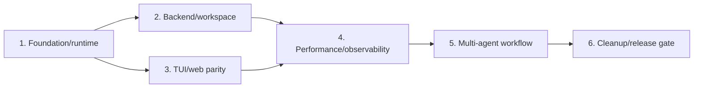

# Compass A+ Program Implementation Plan

> **For agentic workers:** REQUIRED SUB-SKILL: Use superpowers:subagent-driven-development (recommended) or superpowers:executing-plans to implement this plan task-by-task. Steps use checkbox (`- [ ]`) syntax for tracking.

**Goal:** Turn Compass into a reliable, student-maintainable TUI and web coding agent with bounded multi-agent delegation, while preserving every currently working feature and repairing broken or falsely advertised behavior.

**Architecture:** Keep the existing FastAPI, React, LangGraph, PostgreSQL, and local-TUI stack. First establish one transport-neutral runtime contract and one safe executor loop; then repair workspace/session ownership, align TUI and web, remove measured latency amplification, and finally add a coordinator that delegates bounded read-only work to existing skill/subagent machinery and synthesizes structured artifacts. No microservices, distributed queue, scheduler daemon, CRDT, or VS Code work is included.

**Tech Stack:** Python 3.12, LangGraph 1.2.9-compatible APIs, LangChain, FastAPI, SQLAlchemy 2, PostgreSQL, React 19, TypeScript 6, Vite 8, CodeMirror 6, Nginx, Docker Compose, Python `unittest`, Vitest and Testing Library for focused frontend behavior.

## Global Constraints

- Preserve all observable working TUI and web behavior; a feature may be removed only after a reachability test proves it is dead and its user-facing intent is retained or explicitly marked unavailable.
- Keep Ask, Edit, Plan, and Goal modes in both TUI and web.
- Keep web shell execution and browser-configured command MCP disabled.
- Keep local TUI shell and local MCP available only behind explicit approval and workspace-aware policy.
- Use one shared runtime event and resume-action vocabulary across graph, backend, TUI, and web.
- Never branch away from an assistant message containing tool calls until every call has a matching `ToolMessage`.
- Default multi-agent concurrency is `2`; hard maximum is `4`; nested delegation is disabled.
- Multi-agent workers are read-only in the first release; only the coordinator/main executor may apply writes after approval.
- Add no Redis, Celery, Kafka, worker daemon, distributed lock service, CRDT, collaborative editing, browser automation, or plugin marketplace.
- Do not work on the VS Code extension.
- Do not reset, clean, or overwrite the current dirty worktree. Before execution, obtain an explicit user choice for a safety commit or a separate copy that contains the current source state.
- Use test-first steps and path-scoped commits. Never stage unrelated user changes.
- A task is complete only after its focused tests and the current regression suite pass.

---

## Program Boundaries

This program is intentionally split into six independently reviewable plans. Each produces working, testable behavior before the next begins.

| Order | Plan | User-visible increment | Primary risk retired |
|---:|---|---|---|
| 1 | [Foundation, safety, and runtime contract](2026-08-11-compass-01-foundation-runtime.md) | Trusted startup, valid tool loop, working approval/clarification, DB-optional current-process TUI | Startup code execution, graph invariant failures, broken interrupts |
| 2 | [Backend, workspace, and BYOK integrity](2026-08-11-compass-02-backend-workspace.md) | Correct workspace/session selection, reliable GitHub binding, provider-safe credentials, accurate run lifecycle | Wrong-owner/wrong-workspace mutations, pinned DB sessions, credential crossover |
| 3 | [TUI and web parity](2026-08-11-compass-03-tui-web-parity.md) | Identical action semantics and run artifacts in both surfaces, safe task switching, reliable editor/patch state | Approve-once denial, cross-task events, stale editor/patch writes |
| 4 | [Performance and observability](2026-08-11-compass-04-performance-observability.md) | Per-stage timing/cost plus fewer repeated DB, memory, MCP, workspace, and render operations | Unmeasured slowness and latency amplification |
| 5 | [Rules, checkpoints, hooks, and bounded multi-agent](2026-08-11-compass-05-multi-agent-workflow.md) | Project instructions, restore/fork, verification hooks, 2–4 read-only workers, coordinator walkthrough | Missing Claude/Codex/Antigravity-style daily workflow |
| 6 | [Hardening, cleanup, documentation, and release gate](2026-08-11-compass-06-hardening-cleanup.md) | Honest docs/commands, deterministic setup, removal of proven dead code, full smoke matrix | Stale claims and student-unfriendly maintenance surface |

## Audit-to-Task Coverage

This matrix is the scope ledger. An audit finding is not considered addressed until the named task has a failing test, the smallest implementation, and passing verification.

| Audit finding or requested capability | Owning plan/task | Required outcome |
|---|---|---|
| Import-time execution of repository custom tools | Plan 1, Task 2 | Discovery is metadata-only; code loads only after trust and approval |
| Workspace-root or traversal deletion | Plan 2, Task 1 | Canonical owned-path resolver rejects root and escape targets |
| Production web cannot reach HTTP/WebSocket API | Plan 1, Task 9 | Browser, Vite, Nginx, and Compose share one same-origin `/api` contract |
| Unmatched tool calls and invalid graph edges | Plan 1, Tasks 3–4 | Public tool registry plus a graph invariant test for every tool call |
| Unbounded Goal/recovery loops | Plan 1, Task 4 | Configured hard limit with truthful incomplete/failed terminal state |
| TUI fails without PostgreSQL | Plan 1, Task 6 | Current-process in-memory checkpointer and local session store |
| Clarification, approve-once, denial, and plan feedback are lost | Plan 1, Task 5; Plan 3, Task 2 | Typed resume payload round-trips unchanged in TUI and web |
| Dead/private `RemoteToolNode` policy path | Plan 1, Task 3; Plan 6, Task 7 | One reachable public tool executor; dead path deleted only after reachability proof |
| False shell containment and direct validation subprocesses | Plan 1, Tasks 3 and 8 | Workspace-aware policy and approval-backed shell execution |
| Compaction does not update checkpoint state | Plan 1, Task 7 | Automatic and manual compaction remove old messages and persist summary |
| Skills, file search, MCP, and linter regressions | Plan 1, Task 8 | Focused regression contract tests for each reachable feature |
| Ownership gaps and ambiguous active workspace | Plan 2, Tasks 1–2 | Every action resolves one owned, explicit active workspace |
| GitHub binding is destroyed by edits | Plan 2, Tasks 2 and 8 | Stable project identity and separate integration connection identity |
| ORM/DB session held across model and tool waits | Plan 2, Task 3 | Immutable run snapshot created inside short database scopes |
| Run history is incomplete or quadratic | Plan 2, Task 4 | Append-only deltas and truthful interrupted/cancelled/failed terminal states |
| BYOK credential crossover or misleading usage | Plan 2, Task 5; Plan 4, Task 2 | Provider-keyed secrets, test/remove operations, actual provider/model and aggregate usage |
| RAG scope and secret policy are ambiguous | Plan 2, Task 6 | Project/version filters, disclosure, and shared secret exclusion policy |
| Patch state is non-atomic or stale | Plan 2, Task 7; Plan 3, Task 5 | Optimistic patch version plus workspace/version preconditions |
| Web sockets, tasks, and editor responses contaminate another session | Plan 3, Tasks 1 and 4 | One abortable run controller and `(workspace_id, path)` editor keys |
| WebSocket credentials appear in query strings and run starts are unbounded | Plan 1, Task 9; Plan 6, Task 3 | Subprotocol authentication plus per-user connection/message/run limits |
| TUI/web feature semantics and artifacts diverge | Plan 3, Tasks 2–8 | Shared event fixture, artifact model, parity commands, and journey suite |
| GitHub paging/branch races and manual saves cannot be published | Plan 3, Task 5 | Generation-safe import UI and bounded current-file selection for publish |
| Repeated memory, MCP, binding, history, and workspace scans cause latency | Plan 4, Tasks 1–4 | Call-budget tests, once-per-turn context, negative cache, incremental metadata |
| Context refresh duplicates requests or updates only local state | Plan 4, Task 4 | Named tree/backend refresh operations invoked once with visible errors |
| Streaming rerenders and oversized frontend payloads | Plan 4, Tasks 5–6 | Render isolation, batching, lazy loading, and measured bundle budgets |
| Missing project rules, verification hooks, restore, and fork | Plan 5, Tasks 1–4 | Lightweight Claude/Codex-style daily workflow in both surfaces |
| Missing bounded multi-agent coordination | Plan 5, Tasks 5–9 | Typed DAG, 2-default/4-max read-only workers, cancellation, synthesis, walkthrough |
| Non-deterministic setup, weak readiness/security limits, stale docs | Plan 6, Tasks 1–8 | Reproducible bootstrap, honest health/config/docs, bounded auth/socket behavior |
| Global mutable web skills and unsafe names | Plan 6, Task 4 | Run-scoped registry, per-user mutation scope, validated names and paths |
| Accessibility/error handling and unproven dead surface | Plan 6, Tasks 6–7 | Keyboard/error tests and test-proven, reviewer-approved cleanup only |
| Inflated session counts, raw storage paths, and unbounded tree/export responses | Plan 2, Tasks 2 and 8 | Pre-aggregated counts, public schemas, bounded/streamed export |
| Unverified OAuth identity, stale HTTP limiter keys, and live sockets after session deletion | Plan 6, Task 3 | Canonical verified identity, pruned weighted limits, cancellation/disconnect |

## Effort and Delivery Forecast

These are focused engineering estimates, not deadlines. They assume one developer who knows Python and React, fake-provider tests for most work, and no new production platform. Discovery during a failing test can change a task estimate before its implementation begins.

| Plan | Focused effort | Notes |
|---|---:|---|
| 1. Foundation/runtime | 8–12 developer-days | Highest-risk invariants, deployment contract, and DB-free TUI |
| 2. Backend/workspace | 10–15 developer-days | Includes three additive migrations and ownership/provider tests |
| 3. TUI/web parity | 8–12 developer-days | Can overlap Plan 2 after Plan 1 with strict file ownership |
| 4. Performance/observability | 6–9 developer-days | Measurement first; only proven hot paths are changed |
| 5. Multi-agent workflow | 12–18 developer-days | Largest new feature, deliberately bounded to one process |
| 6. Hardening/release | 7–10 developer-days | Cleanup is last and requires reachability evidence |
| **Total** | **51–76 developer-days** | Roughly 10–15 weeks for one developer; about 7–11 elapsed weeks for two careful developers |

## Assumptions to Validate at the Execution Gate

- The current dirty worktree is the intended source baseline and must be preserved in a safety commit or copied workspace before implementation.
- PostgreSQL remains the web persistence layer; the local TUI fallback guarantees current-process continuity, not durable cross-process history.
- The first release remains a single backend process; in-process WebSocket limits and orchestration scheduling document that boundary.
- Global installed skills are read-only, web-created skills are per-user, and workspace skills are available only in their workspace/local context.
- Multi-agent workers remain read-only and non-recursive; the coordinator/main executor is the sole writer and still requires normal approval.
- Provider integrations and performance work may be reordered only when Plan 4 measurements or provider contract tests supply contrary evidence.

## Explicit Deferrals

These items are intentionally not part of A+. Keeping them out is what preserves a single-process, student-maintainable implementation. Existing partial behavior is documented honestly; it is not silently deleted.

- VS Code extension work of any kind.
- Multi-process/replica coordination, Redis-backed limits, durable queues, schedulers, and distributed locks.
- WebSocket reconnect with event replay, offline continuation, and cross-process run reattachment.
- A background retention/deletion service for soft-deleted workspaces, vectors, uploads, and checkpoints; A+ cancels live work and documents retained data.
- Durable standalone todo/scheduled-task storage; orchestration tasks remain run artifacts, and `/schedule` remains explicitly unavailable.
- Nested or write-capable workers, autonomous approval, agent chat rooms, and unbounded agent spawning.
- LSP/IDE replacement, CRDT collaboration, multi-root editing, generalized worktree UI, and automatic merge/rebase resolution.
- General WebContainer/package-manager detection, browser automation, and arbitrary web MCP execution.
- Enterprise billing, organization administration, multi-region storage, and deployment autoscaling.

## User-Value Story Breakdown

The epic is split using thin end-to-end workflow slices rather than frontend/backend horizontal layers.

### Story 1: A user can safely open a project and complete one approved tool turn

**As a** local or web Compass user  
**I want** a chat turn to plan, request approval, execute tools, and finish without protocol errors  
**so that** the core coding loop is trustworthy.

**Acceptance criteria:**

- Given an untrusted repository containing `.compass/tools/evil.py`, starting Compass does not execute that file.
- Given an assistant response with two tool calls, the graph produces two matching `ToolMessage` objects before another model message or `END`.
- Given a clarification interrupt, TUI and web both show the question and resume with the supplied answer.
- Given no `DB_URI`, the TUI can complete a current-process chat and approval turn using an in-memory checkpointer.

### Story 2: A user always edits the project and session visible on screen

**As a** web user  
**I want** session, workspace, patch, editor, and GitHub state to share one identity  
**so that** an action can never target a previous or foreign project.

**Acceptance criteria:**

- Switching sessions closes and invalidates the previous run controller before new transcript data is accepted.
- Editor cache keys are `(workspace_id, path)` and late responses cannot overwrite a newer selection.
- Workspace creation/attachment verifies session ownership.
- Editing a GitHub-imported workspace preserves `project_id`, `git_remote`, `git_branch`, and `git_head`.

### Story 3: A user can see where time and tokens went

**As a** BYOK user  
**I want** accurate per-stage timing, model usage, tool duration, and provider identity  
**so that** I can understand speed and cost.

**Acceptance criteria:**

- DONE usage is the sum of planner, executor, evaluator, recovery, summarizer, and worker calls.
- A run artifact reports duration for context, planning, execution, tools, verification, and persistence.
- Memory is recalled once per user turn with the actual query.
- MCP failures use a bounded negative-cache backoff instead of retrying every executor cycle.

### Story 4: A user gets a coding-agent workflow, not just chat

**As a** developer  
**I want** project rules, verification hooks, checkpoints, restore/fork, and a final walkthrough  
**so that** Compass behaves like a practical Claude Code, Codex, or Antigravity-style tool.

**Acceptance criteria:**

- `COMPASS.md`, `AGENTS.md`, `CLAUDE.md`, and `GEMINI.md` are loaded with documented precedence and displayed in context inspection.
- Configured post-edit commands run only after approval, with a timeout and captured result.
- Before a write, Compass records a recoverable file checkpoint; restore deletes files that did not exist in the checkpoint.
- TUI and web show plan, changed files, checks, usage, and final walkthrough from the same artifact model.

### Story 5: A coordinator can delegate independent work without creating a distributed system

**As a** developer with a broad task  
**I want** Compass to delegate independent analysis to a few bounded workers  
**so that** frontend, backend, testing, and research can progress concurrently while one coordinator remains accountable.

**Acceptance criteria:**

- The coordinator creates typed tasks with IDs, dependencies, allowed tools, success criteria, timeout, and token budget.
- At most two workers run by default and four by configuration.
- Workers cannot mutate the workspace or delegate again.
- Cancellation reaches all active workers.
- The coordinator synthesizes worker artifacts, verifies evidence, and is the only component allowed to request/apply writes.

## Dependency and Merge Order

- Plans 2 and 3 may be implemented in parallel only after Plan 1 is merged and their file ownership is respected.
- Within that overlap, Plan 2 Task 2 lands before Plan 3 Task 5 (workspace attach), Plan 2 Task 4 lands before Plan 3 Tasks 1 and 3 integrate (client run ID and shared runner), and Plan 2 Task 5 lands before Plan 3 Task 6 (provider test/remove UI). Frontend-only tests may be prepared earlier against fakes.
- Plan 4 must measure the repaired runtime; do not optimize the broken graph first.
- Plan 5 depends on the shared protocol, run artifact, usage accumulator, tool metadata, workspace identity, and cancellation semantics from Plans 1–4.
- Plan 6 is last because it deletes or rewrites only behavior already protected by tests.

## Program-Level Test Matrix

| Journey | TUI | Web | Required evidence |
|---|---:|---:|---|
| Greeting and ordinary Ask | Yes | Yes | One model call, DONE, no tool state |
| Edit with one safe read and one approved write | Yes | Yes | Matched tool messages, changed-file artifact |
| Plan approve, revise with feedback, cancel | Yes | Yes | Exact resume payload preserved |
| Goal clarification and bounded retry | Yes | Yes | No false DONE while interrupted |
| Session switch during stream | N/A | Yes | Old socket events ignored and server cancelled |
| Workspace attach/switch | Resume context | Yes | Agent and editor resolve identical workspace ID |
| Patch create/apply/reject/undo | Diff/undo | Yes | Creation event, atomic status, correct workspace |
| BYOK test/remove and chat | Config | Settings | Key never crosses provider; actual provider shown |
| Memory and code RAG | Yes | Yes where supported | Stable project/version filters and disclosed embedding provider |
| Explicit skill invocation | Yes | Yes | Skill task reaches worker/manager |
| Rules, hook, checkpoint, restore/fork | Yes | Yes | Same artifact and restore semantics |
| Two independent workers plus synthesis | Yes | Yes | Bounded concurrency and evidence-bearing artifacts |

## Execution Gate

Before the first implementation task:

- [ ] Run `git status --short` and save the output in the execution task notes.
- [ ] Ask the user to choose either a safety commit containing the current worktree or a separate copied workspace containing it.
- [ ] Use `superpowers:using-git-worktrees` after that baseline exists; create a `codex/compass-a-plus` worktree.
- [ ] Recreate the Python environment; do not reuse the broken `.venv` interpreter pointer.
- [ ] Run the existing 13 Python tests and frontend no-emit typecheck/lint to record the true baseline.
- [ ] Stop if baseline behavior differs materially from this audit and update the affected plan before implementation.

## Definition of Done

- Every plan’s focused tests pass.
- The program-level TUI/web journey matrix passes with fake-model integration tests and a documented manual smoke run using one real BYOK provider.
- No user-owned pre-existing change is reset, overwritten, or silently included in a Compass commit.
- No false-success command remains.
- The architecture document and generated workflow diagram match reachable code.
- VS Code remains unchanged.
