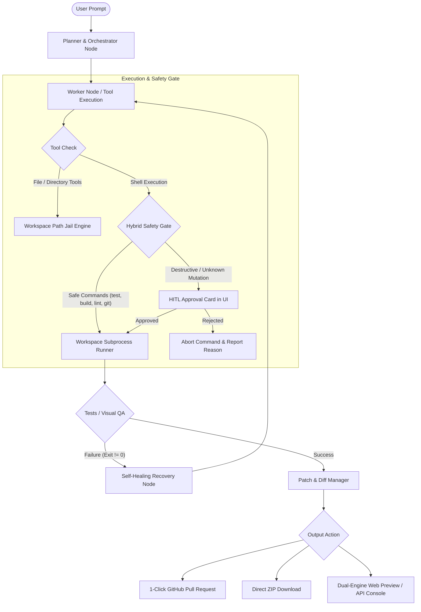

# Compass Architecture Specification: Commercial-Grade Autonomous Software Engineer

**Date**: 2026-10-28  
**Status**: Pending Review  
**Objective**: Eliminate all mock, simulated, and crippled logic across the Compass platform and establish a robust, commercial-grade autonomous software engineering product.

---

## 1. Executive Summary & Product Positioning

### Current State ("Portfolio Project")
Compass previously exhibited several behaviors typical of demonstration projects:
1. **Silent Mock Fallbacks**: Missing API keys or model exhaustion resulted in fabricated assistant messages (`Compass LiteLLM [...]: Processed X messages.`), hiding real errors and confusing users.
2. **Crippled Web Agent Shell**: Shell execution was hard-disabled for web users (`execution_target == "web"`), preventing the agent from running tests, inspecting git status, or installing packages.
3. **Fake Sandbox Fallback**: Without an E2B key, sandbox calls returned hardcoded mock strings (`[compass-sandbox-fallback] Command executed: ...`) with fake `exit_code=0`.
4. **Fragile Previews**: Non-Node projects (static HTML/CSS/JS, Python/Flask backends) crashed `WebPreview` due to a strict `package.json` requirement.
5. **Superficial UI Metrics**: Badges claiming `< 350ms` and `Ready in 2s` created a facade of performance rather than displaying real telemetry.

### Target State ("Commercial-Grade Autonomous Software Engineer")
Compass is positioned as a **lightweight, web-based autonomous software engineering platform** that delivers complete software deliverables from natural language prompts:
- **Autonomous Full-Cycle Loop**: Prompt $\to$ Plan $\to$ Code $\to$ Autonomous Test & Visual QA $\to$ Self-Healing Loop $\to$ Staged Diff Review $\to$ 1-Click GitHub PR / ZIP Export.
- **Zero-Friction Real Execution**: Free-tier OpenRouter models work immediately without mock fallback; quota exhaustion triggers clear, actionable credential prompts.
- **Hybrid Safety Shell**: Agent autonomously runs tests, builds, and linting; destructive or unknown system mutations are gated by Human-in-the-Loop (HITL) approval cards.
- **Universal Multi-Stack Preview**: WebContainers for Node/Vite, live iframe sandbox for static web projects, and interactive API route testers for backend services.
- **Verified Deliverables**: Automated Playwright visual QA and test suite execution guarantee that generated code is tested before the agent claims completion.

---

## 2. Architectural Design & Component Changes



### Component 1: Anti-Mock LLM Universal Router (`agent/llm_router.py`)
- **Remove**: `_is_mock_mode`, `_mock_result`, and `COMPASS_MOCK_LLM` silent fallbacks.
- **Behavior**:
  - Automatically route requests across primary models and OpenRouter free fallbacks (`openrouter/free`, `deepseek/deepseek-r1:free`, `qwen/qwen-2.5-coder-32b-instruct:free`, `meta-llama/llama-3.3-70b-instruct:free`).
  - If no API key is configured and free tier models are unavailable, raise `LLMProviderError` with a structured payload:
    ```json
    {
      "type": "CREDENTIALS_REQUIRED",
      "message": "No API key configured or free-tier quota exhausted. Please configure your OpenRouter or Gemini API key in Settings.",
      "settings_route": "/settings"
    }
    ```
  - The frontend Chat interface intercepts this event and renders an actionable **API Key Required** card with a direct input field or link to Settings.

### Component 2: Real Execution Sandbox Adapter (`agent/sandbox/e2b_adapter.py` & `backend/routers/workspaces.py`)
- **Remove**: All `[compass-sandbox-fallback]` mock strings, simulated exit codes, and dummy file operations.
- **Behavior**:
  - When `E2B_API_KEY` is present and valid, boot and execute in isolated cloud microVM.
  - When `E2B_API_KEY` is not present, transparently execute within the local active workspace using the host subprocess engine (`workspace_dir`).
  - Fix the async context manager bug in `backend/routers/workspaces.py` L742 by properly awaiting `cloud_sb.start()` and `cloud_sb.close()` or using `async with`.

### Component 3: Hybrid Safety Shell Tool (`agent/tools/shell_tool.py` & `agent/safety.py`)
- **Remove**: The arbitrary web target execution block (`if workspace.execution_target == "web" and not verification_hook:`).
- **Behavior**:
  - Enable shell command execution within `workspace.root` for all execution targets.
  - Implement pattern-based auto-approval in `agent/safety.py`:
    - **Safe Patterns (Auto-Approved)**:
      - `npm test`, `pnpm test`, `yarn test`, `bun test`, `vitest`, `jest`
      - `npm run build`, `pnpm run build`, `npm run lint`
      - `pytest`, `python -m unittest`, `python -m pytest`
      - `git status`, `git diff`, `git log`, `git branch`
      - `npm install`, `pnpm install`, `pip install -r requirements.txt` (inside virtualenv/workspace)
      - `tsc --noEmit`, `cargo check`, `go test`
    - **Risky Patterns (Requires HITL Approval)**:
      - File deletions outside build cache (`rm`, `del`, `Remove-Item`)
      - Process management (`kill`, `pkill`)
      - Network downloads outside package managers (`curl`, `wget`)
      - System configuration or root commands (`sudo`, `chmod`, `chown`)
      - Unrecognized or ambiguous shell scripts
  - When approval is required, send `InterruptKind.TOOL_APPROVAL` event to chat, presenting the exact command, working directory, and risk level.

### Component 4: Dual-Engine Web Preview (`frontend/src/components/sandbox/WebPreview.tsx`)
- **Remove**: Strict `package.json` dependency that throws errors for non-Node projects.
- **Behavior**:
  - **Mode A: Node / Vite WebContainer**
    - Triggered when `package.json` is present.
    - Mounts files into `@webcontainer/api`, runs `npm install`, launches Vite/Next dev server, streams URL to preview iframe.
  - **Mode B: Static Live Sandbox (HTML / CSS / JS)**
    - Triggered when `index.html` (or `index.htm`) exists without `package.json`.
    - Compiles virtual project files into an in-memory blob/srcdoc preview with script isolation, postMessage inspection, and instant hot reload.
  - **Mode C: Backend Route & API Console**
    - Triggered when backend files exist (Python `app.py`, `main.py`, FastAPI/Flask routes) without frontend entry points.
    - Renders an interactive endpoint inspector with route auto-discovery and quick curl / test trigger.

### Component 5: Commercial Verification & Self-Healing Loop
- **Integration**:
  - Agent invokes `agent/tools/visual_qa_tool.py` (Playwright) or runs tests via `shell_tool`.
  - When tests fail (exit code $\neq 0$ or console exceptions detected), the agent does not quit or announce success.
  - The `verification_hook` feeds the exact error output and stack trace back into the LangGraph state graph.
  - The agent formulates a patch, modifies the files, and re-executes tests until green or max retry limit is reached.
  - Only when verified does the agent present the diff review and enable 1-Click GitHub PR / ZIP Export.

---

## 3. Implementation Phasing

1. **Phase 1: Anti-Mock Core Engine**
   - Clean up `agent/llm_router.py`: remove fake generation, add typed credential error handling.
   - Clean up `agent/sandbox/e2b_adapter.py`: remove mock simulator; fallback to real local workspace runner.
   - Fix async context manager bug in `backend/routers/workspaces.py`.
2. **Phase 2: Hybrid Safety Shell & Agent Liberation**
   - Update `agent/safety.py`: register safe build/test command patterns for auto-approval.
   - Update `agent/tools/shell_tool.py`: remove web target lockdown; integrate with safety engine.
3. **Phase 3: Universal Preview Engine**
   - Upgrade `frontend/src/components/sandbox/WebPreview.tsx` to support static HTML/JS sandboxes and backend API consoles.
4. **Phase 4: End-to-End Verification & Real-World Validation**
   - Run backend test suite (`tests/test_llm_router.py`, `tests/test_tool_registry.py`, `tests/test_verification_loop.py`).
   - Run frontend tests and production build.
   - Verify complete cycle: prompt $\to$ build $\to$ test $\to$ preview.
