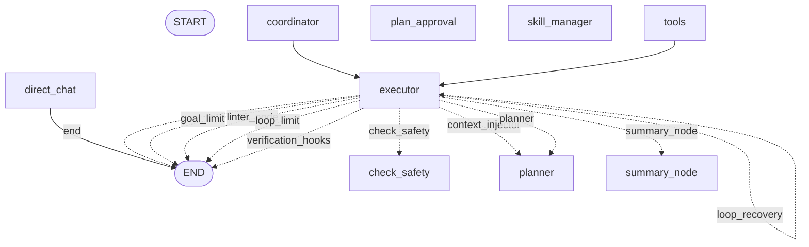

# Compass registered workflow

<!-- Generated by tools/render_workflow.py; do not edit by hand. -->

This diagram is generated from the registered `StateGraph` builder without
compiling or running the graph. Solid arrows are fixed edges. Dotted arrows
are the executor outcomes whose destination map is registered explicitly.
Other conditional routers are listed below because their destinations are
chosen at runtime rather than declared as a static builder map.

## Registered descriptor

- Nodes: 9 runtime nodes, plus START and END.
- Fixed edges: 3.
- Explicit conditional destinations: 11.
- Runtime-selected conditional routers: 6.

| Conditional source | Registered route function |
| --- | --- |
| `__start__` | `_route_start` |
| `check_safety` | `_route_after_safety` |
| `plan_approval` | `_route_after_plan_approval` |
| `planner` | `_route_after_planner` |
| `skill_manager` | `_route_after_skill_manager` |
| `summary_node` | `_route_after_summary` |

## Operational reading

- Short read-only requests may enter `direct_chat` and finish without the tool loop.
- Planning can pass through `planner`, `plan_approval`, and bounded read-only `coordinator` workers before `synthesis` returns to the single `executor` spine.
- Tool calls pass through `check_safety`; explicit interrupts collect plan or tool approval before execution resumes.
- Goal work may use linting, evaluation, limits, context injection, recovery, and threshold-based `summary_node` compaction.
- Post-edit verification hooks are scheduled by the executor path, approved through the same safety boundary, and finalized before END.
