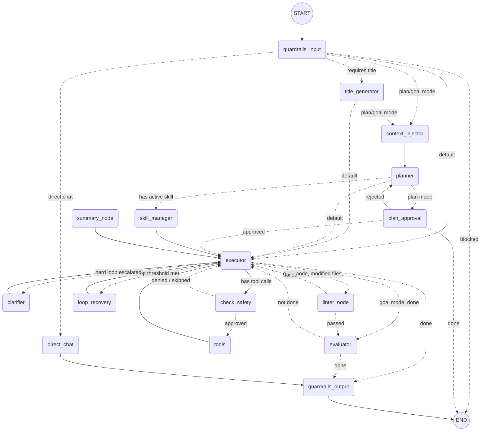

# LangGraph Workflow Architecture

Based on the `agent/graph/workflow.py` definitions, here is the full visual representation of the agent's workflow using Mermaid.

### Key Behaviors:
- **Safety checks**: Occur on input and output (guardrails), and before every tool execution (check_safety).
- **Tool usage**: The `executor` produces tool calls, they go through `check_safety`, and then to `tools`, which routes back to the `executor`.
- **Loop recovery**: Unproductive loops are sent to `loop_recovery` or escalated to a `clarifier` node.
- **Verification**: In goal mode, any file edits are verified by a `linter_node` and then an `evaluator` before being considered done.
- **Planning**: In plan mode, a `planner` generates a plan and pauses at `plan_approval` before the `executor` proceeds.
