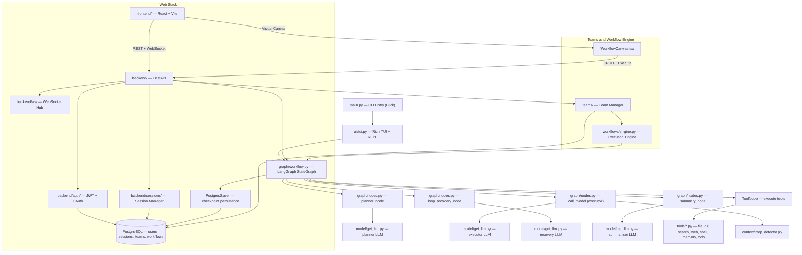
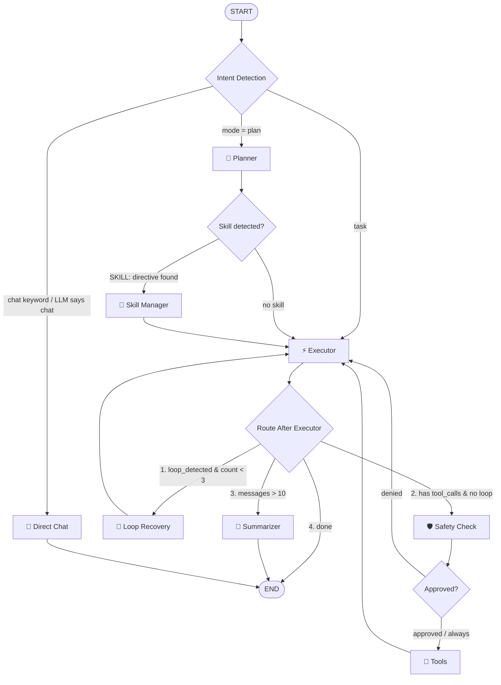

# 🧭 Compass — Development Roadmap

> **What**: A terminal-based AI coding agent (like Claude Code) built with **LangChain + LangGraph**.
> **Why**: Replace the hand-rolled complexity of [RivaanRanawat/ai-coding-agent](https://github.com/RivaanRanawat/ai-coding-agent) with framework-powered simplicity — then go beyond it with Skills and RAG.

---

## Current Progress

| Phase | Status | Description |
|-------|--------|-------------|
| Phase 0 — Project Setup | ✅ Done | Skeleton, deps, LLM call |
| Phase 1 — Basic Agent Graph | ✅ Done | LangGraph loop + single tool |
| Phase 2 — All Built-in Tools | ✅ Done | All 10 tools implemented and wired into the graph |
| Phase 3 — Terminal UI + Streaming | ✅ Done | Rich TUI + REPL + streaming done |
| Phase 4 — Safety & Approval | ✅ Done | Human-in-the-loop, dangerous command detection |
| Phase 5 — Context + Persistence | ✅ Done | Checkpointer + thread_id + summary compaction + loop detection implemented |
| Phase 6 — Advanced Features | ✅ Done | Multi-agent, MCP adapter, dynamic tool loading, TOML config |
| Phase 7 — Skill Manager Agent | ✅ Done | SKILL.md + sub-agent spawner + skill orchestrator |
| Phase 8 — RAG | ✅ Done | Codebase indexing + semantic search + file uploads |
| Phase 9 — Scheduling, Hooks & Polish | ⬜ Not started | Scheduler daemon, lifecycle hooks, full feature parity |
| Phase 10 — FastAPI Backend | ✅ Done | Auth, sessions, chat, WS, middleware, file uploads all implemented |
| Phase 11 — React Frontend | 🔶 In Progress | Scaffolding done; ChatPage, AppLayout, LoginModal, SettingsDrawer, CodeSandbox built; remaining components pending |
| Phase 12 — Teams & Workflow Builder | ⬜ Not started | User-defined agent teams, visual workflow canvas, prompt-based orchestration |
| Phase 13 — VS Code Extension | ⬜ Not started | Professional Webview UI, workspace context injection, file upload, slash commands |

---

## Architecture



---

## Current Workflow (Live Graph)

> The actual LangGraph `StateGraph` as implemented in [`workflow.py`](file:///d:/projects/compass/graph/workflow.py) and [`nodes.py`](file:///d:/projects/compass/graph/nodes.py).

### Nodes (8 total)

| Node | Agent | Purpose |
|------|-------|---------|
| `START` | Router | LLM-powered intent detection: chat vs task vs plan |
| `planner` | 🧠 Planner | Decomposes user query → numbered step-by-step plan; parses `SKILL:` directives |
| `skill_manager` | 🎯 Skill Manager | Looks up skill in registry → spawns isolated sub-agent via `SubAgentFactory` |
| `executor` | ⚡ Executor | Follows plan, calls tools, detects loops; binds built-in + custom + MCP tools |
| `direct_chat` | 💬 Direct Chat | Fast path for greetings/simple questions — no tools, saves tokens |
| `check_safety` | 🛡️ Safety | Intercepts risky tool calls → `interrupt()` for human approval |
| `tools` | 🔧 RemoteToolNode | Executes the actual tool calls (13 built-in + custom + MCP tools) |
| `loop_recovery` | 🔄 Recovery | Analyzes stuck loops, provides corrective guidance (max 3 attempts) |
| `summary_node` | 📝 Summarizer | Compacts conversation via `RemoveMessage` when messages > 10 |

### Graph Flow



### Routing Logic

**`_route_start`** (START → ?):
1. If `mode == "plan"` → `planner` (full planning pipeline)
2. If message matches chat keywords (`hi`, `hello`, `thanks`, etc.) AND < 50 chars → `direct_chat`
3. Else, use LLM to classify: `"chat"` → `direct_chat`, `"task"` → `executor`
4. Fallback → `executor`

**`_route_after_planner`** (planner → ?):
- If `active_skill` is set (parsed `SKILL:` directive) → `skill_manager`
- Otherwise → `executor`

**`_route_after_executor`** (executor → ?) — Priority order:
1. `loop_detected == True` AND `loop_count < 3` → `loop_recovery`
2. Last message has `tool_calls` AND no loop → `check_safety`
3. `len(messages) > 10` → `summary_node`
4. Otherwise → `END`

**`_route_after_safety`** (check_safety → ?):
- `approval_status == "approved"` → `tools`
- `approval_status == "denied"` → `executor` (with error ToolMessages)

### State Fields ([`AgentState`](file:///d:/projects/compass/graph/state.py))

```python
class AgentState(TypedDict):
    # Core
    messages: list[BaseMessage]     # Conversation history (add_messages reducer)
    turn_count: int                 # Executor invocations
    summary: str                    # Compacted conversation context
    mode: str                       # "normal" or "plan"
    
    # Planner
    plan: str                       # Step-by-step plan text
    current_step: int               # Which step executor is on
    
    # Executor
    is_done: bool                   # True = final answer (no tool calls)
    pending_tool_calls: list[dict]  # [{name, args}] from model response
    approval_status: str | None     # "approved" | "denied"
    approved_operations: list[str]  # Cache of auto-approved operations
    token_usage: dict               # {prompt_tokens, completion_tokens, total_tokens}
    
    # Loop Recovery
    loop_detected: bool             # Set by is_looping() in call_model
    loop_count: int                 # Consecutive loops (hard break at 3)
    recovery_guidance: str          # Corrective text from recovery agent
    
    # Skills
    active_skill: dict | None       # {"name": "...", "arguments": "..."}
    skill_result: dict | None       # Result from sub-agent execution
```

### Tools (13 built-in + dynamic)

| Tool | Source | Description |
|------|--------|-------------|
| `read_file` | `tools/file_tools.py` | Read file contents |
| `write_to_file` | `tools/file_tools.py` | Write/create files |
| `edit_file` | `tools/file_tools.py` | Edit existing files |
| `list_dir` | `tools/directory_tools.py` | List directory contents |
| `find_files` | `tools/directory_tools.py` | Find files by pattern |
| `grep_search` | `tools/search_tools.py` | Regex/text search |
| `codebase_search` | `rag/retriever.py` | Semantic search via ChromaDB |
| `web_search` | `tools/web_tools.py` | Web search (Tavily/DDG) |
| `shell_execute` | `tools/shell_tool.py` | Shell commands (with safety) |
| `memory` | `tools/memory_tool.py` | Key-value memory store |
| `todo` | `tools/todo_tool.py` | Task list management |
| `create_skill` | `tools/create_skill_tool.py` | Create new SKILL.md files |
| _Custom tools_ | `.compass/tools/` | User-defined `@tool` functions |
| _MCP tools_ | `mcp_client/adapter.py` | Dynamically loaded from MCP servers |

---

## Project Structure

```
compass/
├── main.py                    # CLI entry point (Click: REPL + single-shot -m)
├── .env                       # API keys (OpenRouter, Postgres)
│
├── graph/                     # LangGraph agent core
│   ├── state.py               # AgentState TypedDict
│   ├── nodes.py               # planner + executor + loop_recovery + summary nodes
│   ├── remote_tool_node.py    # Remote tool execution node
│   └── workflow.py            # Graph assembly + checkpointer
│
├── model/
│   └── get_llm.py             # LLM configuration (OpenRouter)
│
├── tools/                     # All agent tools
│   ├── file_tools.py          # read_file, write_to_file, edit_file
│   ├── directory_tools.py     # list_dir, find_files
│   ├── search_tools.py        # grep_search
│   ├── web_tools.py           # web_search (Tavily / DuckDuckGo)
│   ├── shell_tool.py          # shell_execute (with safety blocklist)
│   ├── memory_tool.py         # Key-value memory store
│   └── todo_tool.py           # Task list management
│
├── skills/                    # Skill Manager Agent
│   ├── models.py              # SkillDefinition dataclass
│   ├── loader.py              # Parse SKILL.md frontmatter + body
│   ├── registry.py            # SkillRegistry singleton
│   ├── manager.py             # SkillManagerAgent orchestrator
│   └── subagent_factory.py    # SubAgentFactory — builds per-skill sub-graphs
│
├── rag/                       # Codebase Intelligence
│   ├── chunker.py             # Code-aware splitting
│   ├── indexer.py             # Index workspace into ChromaDB
│   ├── retriever.py           # codebase_search tool
│   ├── loaders.py             # Document loaders
│   ├── vector_store.py        # ChromaDB vector store wrapper
│   └── uploads.py             # File upload + RAG indexing
│
├── mcp_client/                # MCP Integration
│   └── adapter.py             # MCP server connections via langchain-mcp-adapters
│
├── config/                    # Configuration
│   ├── settings.py            # Pydantic settings
│   └── loader.py              # Multi-layer TOML config merging
│
├── context/                   # Context Management
│   └── loop_detector.py       # Detect repeated tool call cycles
│
├── safety/                    # Safety & Approval
│   ├── approval.py            # Approval policies
│   └── validators.py          # Path validation, binary detection
│
├── ui/                        # Terminal UI
│   └── tui.py                 # Rich TUI — REPL, streaming, slash commands
│
├── backend/                   # FastAPI backend (Phase 10) ✅
│   ├── main.py                # FastAPI app entry, CORS, lifespan
│   ├── config.py              # Pydantic Settings (DB, JWT secret, OAuth keys)
│   ├── db.py                  # SQLAlchemy engine + SessionLocal + get_db
│   ├── models/                # SQLAlchemy ORM models
│   │   ├── user.py            # User (id, email, hashed_password, avatar, etc.)
│   │   ├── session.py         # ChatSession (id, user_id, title, thread_id)
│   │   └── message.py         # Message (id, session_id, role, content, tool_calls)
│   ├── schemas/               # Pydantic request/response schemas
│   │   ├── auth.py            # LoginRequest, RegisterRequest, TokenResponse
│   │   ├── chat.py            # ChatRequest, ChatResponse, StreamEvent
│   │   └── session.py         # SessionCreate, SessionList, SessionDetail
│   ├── auth/                  # Authentication & authorization
│   │   ├── jwt.py             # JWT token creation & verification
│   │   ├── oauth.py           # Google / GitHub OAuth2 flows
│   │   ├── passwords.py       # bcrypt hashing & verification
│   │   └── dependencies.py    # get_current_user FastAPI dependency
│   ├── routers/               # API route modules
│   │   ├── auth.py            # POST /auth/register, /auth/login, /auth/refresh, /auth/me
│   │   ├── chat.py            # POST /chat/send, WebSocket /chat/ws/{session_id}
│   │   ├── sessions.py        # CRUD /sessions (list, create, get, rename, delete)
│   │   ├── tools.py           # GET /tools (list available tools)
│   │   ├── settings.py        # GET/PUT /settings (user preferences)
│   │   └── uploads.py         # POST /uploads (file upload + RAG indexing)
│   ├── services/              # Business logic layer
│   │   ├── agent_runner.py    # Wraps graph/workflow.py for async invocation
│   │   └── session_manager.py # Session lifecycle, thread_id mapping
│   ├── ws/                    # WebSocket layer
│   │   └── hub.py             # Connection manager, broadcast, heartbeat
│   └── middleware/            # Custom middleware
│       ├── rate_limit.py      # Per-user rate limiting
│       └── logging.py         # Request/response structured logging
│
├── frontend/                  # React + Vite + TailwindCSS frontend (Phase 11) 🔶
│   ├── index.html             # HTML entry point
│   ├── vite.config.ts         # Vite config (proxy to backend)
│   ├── package.json
│   ├── tsconfig.json
│   └── src/
│       ├── main.tsx           # React entry, router mount
│       ├── App.tsx            # Root component, route definitions
│       ├── api.ts             # Axios-based API client
│       ├── index.css          # TailwindCSS v4 + dark mode
│       ├── pages/
│       │   ├── ChatPage.tsx          # Main chat interface
│       │   ├── AuthCallback.tsx      # OAuth callback handler
│       │   ├── TeamsPage.tsx         # (Phase 12) Teams dashboard
│       │   └── WorkflowEditorPage.tsx # (Phase 12) Visual workflow canvas
│       ├── components/
│       │   ├── layout/
│       │   │   └── AppLayout.tsx      # Sidebar + header + main area
│       │   ├── chat/
│       │   │   └── ChatInput.tsx      # Message input bar + send button
│       │   ├── auth/
│       │   │   └── LoginModal.tsx     # Login/register modal + OAuth
│       │   ├── settings/
│       │   │   └── SettingsDrawer.tsx # Settings drawer panel
│       │   ├── sandbox/
│       │   │   ├── CodeSandbox.tsx    # Monaco-based code sandbox
│       │   │   └── FileExplorer.tsx   # File tree explorer
│       │   ├── teams/                # (Phase 12)
│       │   │   ├── TeamCard.tsx
│       │   │   └── CreateTeamModal.tsx
│       │   ├── workflows/            # (Phase 12)
│       │   │   ├── WorkflowCanvas.tsx
│       │   │   ├── WorkflowNode.tsx
│       │   │   └── NodePalette.tsx
│       │   ├── ThemeProvider.tsx
│       │   └── ThemeToggle.tsx
│       └── lib/               # Utilities
│
├── workflows/                 # (Phase 12) Workflow execution engine
│   ├── engine.py              # Convert graph_json → LangGraph StateGraph
│   ├── nodes.py               # Pre-built node types (llm, tool, skill, conditional)
│   ├── validator.py           # DAG validation (no cycles, valid configs)
│   ├── runner.py              # Compile → stream → persist results
│   └── templates.py           # Pre-built team templates
│
├── scheduler/                 # (Phase 9) Background task scheduling
│   ├── store.py               # Persistent task queue (JSON + filelock)
│   ├── engine.py              # Background execution engine
│   └── daemon.py              # Standalone daemon process + PID management
└── hooks/                     # (Phase 9) Pre/post lifecycle hooks
```

---

## What Replaces What

The original repo does everything manually. Here's what the frameworks handle for us:

| Hard Part (Original) | Easy Part (Compass) |
|---|---|
| Hand-rolled agentic loop (200+ lines) | LangGraph `StateGraph` (~20 lines) |
| Raw OpenAI SDK + stream parsing | `ChatOpenRouter` / `ChatOpenAI` one-liner |
| Custom event pub/sub system | LangGraph `.stream()` events |
| Manual message history + token counting | `MessagesState` + `add_messages` reducer |
| Abstract Tool class + registry + schemas | `@tool` decorator + `ToolNode` |
| Custom JSON session persistence | `PostgresSaver` checkpointer |
| Complex approval manager | LangGraph `interrupt()` |
| Manual sub-agent instantiation | LangGraph sub-graph composition |
| Custom MCP client from scratch | `langchain-mcp-adapters` |

---

## Phase Details

### Phase 0 — Project Setup ✅

- [x] `pyproject.toml` + virtual environment
- [x] Install core deps (langchain, langgraph, etc.)
- [x] `.env` with OpenRouter API key + Postgres URI
- [x] Minimal `main.py` that calls an LLM

---

### Phase 1 — Basic Agent Graph ✅

- [x] `graph/state.py` — `AgentState` with messages, turn_count, etc.
- [x] `graph/nodes.py` — `call_model` node
- [x] `graph/workflow.py` — StateGraph with model → tools loop
- [x] Wire up in `main.py`

**Graph flow (Phase 1 — superseded by current multi-agent architecture, see [Current Workflow](#current-workflow-live-graph) above):**
```
Original:  START → call_model → tools → call_model (loop) → END
Current:   START → intent_router → planner/executor/direct_chat → safety → tools → loop_recovery → summary → END
```

---

### Phase 2 — All Built-in Tools ✅

- [x] `file_tools.py` — read_file, write_to_file, edit_file
- [x] `directory_tools.py` — list_dir, find_files
- [x] `search_tools.py` — grep_search
- [x] `web_tools.py` — web_search (Tavily + DuckDuckGo fallback)
- [x] `memory_tool.py` — set, get, delete, list
- [x] `shell_tool.py` — shell_execute (with blocked command patterns, env sanitization, output truncation)
- [x] `todo_tool.py` — add, complete, list, clear
- [x] **All 10 tools wired** into both `bind_tools()` in `nodes.py` and `ToolNode` in `workflow.py`

---

### Phase 3 — Terminal UI + Streaming ✅

- [x] `ui/tui.py` — Rich theme, panels, styled console (`CompassConsole` class)
- [x] ASCII banner with model info and help hint
- [x] Tool call visualization (invocation + args + results + errors)
- [x] Agent response rendering in styled panels with Markdown
- [x] Thinking spinner with `Rich.Live`
- [x] Interactive REPL loop with slash commands (`/help`, `/exit`, `/clear`, `/model`, `/tools`, `/history`, `/compact`)
- [x] Single-run mode (`python main.py -m "do something"`)
- [x] Session stats in goodbye panel (turn count, elapsed time)
- [x] Streaming via `workflow.stream(stream_mode='updates')` with real-time event processing
- [x] `ui/callbacks.py` — *Superseded*: Token-level streaming natively achieved via LangGraph's `.stream(stream_mode=["messages", "updates"])` and `Rich.Live`.
- [x] `/config` slash command — Implemented basic JSON-backed settings manager.

---

### Phase 4 — Safety & Approval ✅

- [x] `shell_tool.py` — Dangerous command regex blocklist (partial safety: rm -rf, fork bombs, mkfs, etc.)
- [x] `shell_tool.py` — Sensitive env var stripping (API keys, tokens, passwords)
- [x] `safety/approval.py` — Formal approval policies
- [x] `safety/validators.py` — Path validation, binary detection
- [x] `check_safety` node using LangGraph `interrupt()`
- [x] Approval policies: auto, on-request, yolo

**Graph flow with safety:**
```
call_model → has tool calls? → YES → check_safety → safe? → YES → tools
                                                           → NO  → interrupt (ask user)
```

> [!NOTE]
> `shell_tool.py` already has inline safety (blocked patterns + sanitized env), but the formal approval system with `interrupt()` is not yet implemented.

---

### Phase 5 — Context Management + Persistence 🔶

- [x] `PostgresSaver` checkpointer configured
- [x] Checkpointer lifecycle fixed (manual `__enter__()` keeps connection alive)
- [x] `thread_id` generated per session via `uuid.uuid4().hex` in `tui.py`
- [x] Graceful fallback when DB_URI is not set or DB is unavailable
- [x] `summary_node` wired into graph — compacts context via `RemoveMessage` when messages exceed threshold
- [x] `_route_after_model` conditional routing: tools → summary → end
- [x] `context/loop_detector.py` — Detect repeated tool call cycles
- [x] Session resume support (`--resume` and `-s <session_id>`)

--- 

### Phase 6 — Advanced Features

- [x] `graph/nodes.py` — Multi-agent system: planner, executor, loop recovery, summarizer
- [x] `mcp/adapter.py` — MCP server connections via `langchain-mcp-adapters`
- [x] `tools/discovery.py` — Dynamic tool loading from `.compass/tools/`
- [x] `config/loader.py` — Multi-layer TOML config merging

---

### Phase 7 — Skill Manager Agent + Sub-Agents

> Combines Skills (SKILL.md templates) with dynamic sub-agent spawning. The Skill Manager acts as an orchestrator: it discovers skills, spawns isolated sub-agents to execute them, and creates sub-agents on-the-fly when no matching skill exists.

**7a — SKILL.md Discovery & Registry**
- [x] `skills/models.py` — `SkillDefinition` dataclass (name, description, system_prompt, allowed_tools, args_schema)
- [x] `skills/loader.py` — Parse SKILL.md frontmatter (YAML) + body (instructions) from `.compass/skills/`
- [x] `skills/registry.py` — `SkillRegistry` singleton — load, get, list, register skills at startup
- [x] Auto-register skills as `/slash-commands` in the TUI

**7b — Sub-Agent Factory**
- [x] `skills/subagent_factory.py` — `SubAgentFactory` — builds isolated LangGraph sub-graphs per skill
  - Creates a mini `StateGraph` with: skill-specific system prompt → executor → tool loop
  - Tool isolation: only binds the `allowed_tools` declared in the skill
  - Own LLM instance (can use a cheaper/faster model for simple skills)
  - Returns result to the parent graph

**7c — Skill Manager Node**
- [x] `skills/manager.py` — `SkillManagerAgent` — the orchestrator node
  - Receives a skill invocation (from planner or user slash command)
  - Looks up skill in registry → spawns sub-agent via factory
  - If **no matching skill exists** → dynamically creates an ad-hoc sub-agent with a generated system prompt + full tool access
  - Collects sub-agent result → returns to parent graph state

**7d — Graph Integration**
- [x] `graph/workflow.py` — Add `skill_manager` node + routing from planner
  - Planner detects when a task matches a registered skill
  - Route: `planner → skill_manager → executor` (skill result fed back as context)
- [x] `graph/state.py` — Add `active_skill`, `skill_result` fields

**7e — Built-in Skills**
- [x] `.compass/skills/code-review.md` — Code review skill
- [x] `.compass/skills/test-generator.md` — Unit test generation skill
- [x] `.compass/skills/refactor.md` — Refactoring assistant skill
- [x] `.compass/skills/explain.md` — Code explanation skill

**SKILL.md format:**
```yaml
---
name: code-review
description: "Perform a thorough code review"
allowed_tools: [read_file, grep_search, codebase_search]
model: google/gemma-4-31b-it:free  # optional, defaults to executor model
args: "$FILES"
---

You are a senior code reviewer. Review the following files for:
- Bugs and logic errors
- Security vulnerabilities
- Performance issues
- Code style and best practices

Files to review: $ARGUMENTS
```

---

### Phase 8 — RAG (Codebase Intelligence)

> Semantic search so the agent *understands* the project — way smarter than grep.

- [x] `rag/chunker.py` — Code-aware splitting (preserve functions/classes)
- [x] `rag/indexer.py` — Index workspace into ChromaDB
- [x] `rag/retriever.py` — `codebase_search` tool for the agent
- [x] `/index` command to trigger re-indexing
- [x] Incremental indexing (only changed files)

---

### Phase 9 — Scheduling, Hooks & Polish

> Combines the scheduler agent (background task execution), lifecycle hooks (extensible event system), and final polish items.

**9a — Scheduler Agent**

> Two-process architecture: the REPL schedules tasks, a standalone daemon executes them — even when Compass is closed. Communication via shared JSON file with file-locking.

- [ ] `scheduler/store.py` — `TaskStore` with file-locked JSON persistence (`.compass/scheduled_tasks.json`)
- [ ] `scheduler/daemon.py` — Standalone background daemon (detached process, PID management, auto-start/stop)
- [ ] `scheduler/engine.py` — Polling loop that finds due tasks and executes them via `get_workflow()`
- [ ] `tools/scheduler.py` — `@tool` for the agent to schedule tasks (`delay_minutes`, `fire_at`, `cron`)
- [ ] `/schedule` slash commands — `list`, `cancel <id>`, `results <id>`, `log`, `daemon`, `stop`
- [ ] Startup notifications for tasks completed while Compass was closed
- [ ] Between-turn notifications for tasks completing mid-session
- [ ] Cron support for recurring tasks (via `croniter`)

**9b — Lifecycle Hooks**

- [ ] `hooks/hook_manager.py` — Event bus for pre/post lifecycle hooks
- [ ] `graph/builder.py` — `HookableGraphBuilder` (auto-instruments nodes, no hardcoding)
- [ ] `hooks/discovery.py` — Dynamic hook loading from `.compass/hooks/`
- [ ] Built-in hooks: timing logger, file audit, token tracker

**9c — Polish & Feature Parity**

- [ ] System prompt with AGENT.md support
- [ ] Token usage tracking & display
- [ ] Config slash commands
- [ ] Error handling & graceful degradation
- [ ] Comprehensive testing
- [ ] Documentation

---

### Phase 10 — FastAPI Backend ✅

> Expose the agent as a web service with proper auth, session management, and real-time streaming.

**10a — Foundation & Database**
- [x] `backend/main.py` — FastAPI app with CORS, lifespan events, exception handlers
- [x] `backend/config.py` — Pydantic Settings loading from `.env` (DB_URI, JWT_SECRET, OAUTH keys)
- [x] `backend/db.py` — SQLAlchemy engine + `SessionLocal` factory + `get_db` dependency
- [x] `backend/models/user.py` — `User` ORM model (id, email, hashed_password, display_name, avatar_url, oauth_provider, is_active, created_at, updated_at, preferences)
- [x] `backend/models/session.py` — `ChatSession` ORM model (id, user_id FK, title, thread_id, is_deleted soft-delete, created_at, updated_at)
- [x] `backend/models/message.py` — `Message` ORM model (id, session_id FK, role, content, tool_calls JSON, tool_call_id, model, token_count, created_at)
- [x] `backend/schemas/auth.py` — `RegisterRequest`, `LoginRequest`, `TokenResponse`, `UserResponse`
- [x] `backend/schemas/session.py` — `SessionCreate`, `SessionRename`, `SessionSummary`, `SessionDetail`
- [x] `backend/schemas/chat.py` — `ChatRequest`, `ChatResponse`, `StreamEvent`, `ToolCallData`, `MessageResponse`, `WsClientMessage`
- [x] Alembic migrations setup for schema versioning

**10b — Authentication**
- [x] `backend/auth/passwords.py` — bcrypt hash + verify utilities
- [x] `backend/auth/jwt.py` — Access token (15m) + refresh token (7d) creation & verification
- [x] `backend/auth/dependencies.py` — `get_current_user` FastAPI dependency (extracts & validates JWT)
- [x] `backend/routers/auth.py` — Endpoints:
  - `POST /auth/register` — Create user, return tokens
  - `POST /auth/login` — Verify credentials, return tokens
  - `POST /auth/refresh` — Rotate refresh token
  - `GET /auth/me` — Return current user profile
  - `POST /auth/logout` — Invalidate refresh token
- [x] `backend/auth/oauth.py` — Google + GitHub OAuth2 login flows

**10c — Session Management**
- [x] `backend/services/session_manager.py` — Create/list/rename/delete chat sessions per user
- [x] `backend/routers/sessions.py` — CRUD endpoints:
  - `GET /sessions` — List user's sessions (paginated, sorted by updated_at)
  - `POST /sessions` — Create new session (auto-generates thread_id)
  - `GET /sessions/{id}` — Get session with message history
  - `PATCH /sessions/{id}` — Rename session
  - `DELETE /sessions/{id}` — Soft-delete session
- [x] Auto-title generation (LLM summarizes first exchange into a session title)

**10d — Chat API & Streaming**
- [x] `backend/services/agent_runner.py` — Async wrapper around `graph/workflow.py`
  - Accepts user message + thread_id, invokes the LangGraph agent
  - Yields `StreamEvent` objects (token, tool_call, tool_result, done)
- [x] `backend/routers/chat.py` — `POST /chat/send` (non-streaming fallback)
- [x] `backend/ws/hub.py` — WebSocket connection manager
  - Auth via token query param on connect
  - Per-session rooms, heartbeat/ping-pong, graceful disconnect
- [x] `backend/routers/chat.py` — `WebSocket /chat/ws/{session_id}`
  - Client sends `{"type": "message", "content": "..."}`
  - Server streams back `{"type": "token|tool_call|tool_result|done", ...}`
- [x] `backend/schemas/chat.py` — Pydantic models for all WS message types (moved to 10a)

**10e — Supporting APIs**
- [x] `backend/routers/tools.py` — `GET /tools` (list available agent tools + descriptions)
- [x] `backend/routers/settings.py` — `GET/PUT /settings` (user preferences: theme, model, etc.)
- [x] `backend/middleware/rate_limit.py` — Token-bucket rate limiter per user
- [x] `backend/middleware/logging.py` — Structured request/response logging


---

### Phase 11 — React Frontend 🔶

> Modern web UI built with React + Vite + TypeScript + TailwindCSS v4. Dark-mode-first, real-time streaming, full auth flows.

**11a — Project Scaffolding**
- [x] Vite + React + TypeScript project in `frontend/`
- [x] Install core deps: `react-router-dom`, `axios`, `lucide-react`, `@monaco-editor/react`, `react-toastify`
- [x] `vite.config.ts` — Dev server proxy `/api` → `localhost:8000`
- [x] `src/index.css` — TailwindCSS v4 + dark mode palette
- [x] `src/App.tsx` — BrowserRouter with route definitions
- [x] `src/api.ts` — Axios-based API client layer

**11b — Authentication**
- [x] `src/components/auth/LoginModal.tsx` — Login/register modal with OAuth buttons
- [x] `src/pages/AuthCallback.tsx` — OAuth callback handler
- [ ] `src/stores/authStore.ts` — Zustand store (user, tokens, isAuthenticated)
- [ ] `src/hooks/useAuth.ts` — Login, register, logout, auto-refresh token logic
- [ ] `src/components/layout/ProtectedRoute.tsx` — Redirect to login if unauthenticated

**11c — Chat Interface**
- [x] `src/pages/ChatPage.tsx` — Main chat page layout
- [x] `src/components/layout/AppLayout.tsx` — Sidebar + header + main content area
- [x] `src/components/chat/ChatInput.tsx` — Auto-resizing textarea, send on Enter
- [ ] `src/components/chat/MessageBubble.tsx` — User/assistant message rendering with Markdown
- [ ] `src/components/chat/ToolCallCard.tsx` — Expandable tool invocation card
- [ ] `src/components/chat/StreamingText.tsx` — Real-time token-by-token display with cursor animation
- [ ] `src/components/chat/CodeBlock.tsx` — Syntax-highlighted code with copy button
- [ ] `src/hooks/useChat.ts` — WebSocket connection, message send/receive, reconnect logic
- [ ] `src/hooks/useSession.ts` — Session CRUD, auto-load history on session switch

**11d — Settings, Sandbox & Theme**
- [x] `src/components/settings/SettingsDrawer.tsx` — Settings drawer panel
- [x] `src/components/sandbox/CodeSandbox.tsx` — Monaco-based code sandbox
- [x] `src/components/sandbox/FileExplorer.tsx` — File tree explorer for sandbox
- [x] `src/components/ThemeProvider.tsx` — Theme context provider
- [x] `src/components/ThemeToggle.tsx` — Light/dark mode toggle
- [ ] User avatar upload & display
- [ ] Keyboard shortcuts panel

**11e — Polish & UX**
- [x] Toast notifications via `react-toastify`
- [ ] Empty state illustrations (no sessions, no messages)
- [ ] Loading skeletons for chat history and session list
- [ ] Responsive design — mobile sidebar drawer, adaptive chat layout
- [ ] Keyboard navigation — `Ctrl+N` new chat, `Ctrl+K` search sessions, `Esc` close modals
- [ ] Smooth scroll-to-bottom on new messages with "scroll to bottom" fab
- [ ] Markdown rendering with LaTeX support (KaTeX) for math-heavy responses

---

### Phase 12 — Teams & Workflow Builder ⬜

> User-defined agent teams with visual workflow orchestration. Users can create "teams" (e.g., Software Team, Social Media Team) — each team is a custom multi-agent workflow that users build via natural language prompts or a visual drag-and-drop canvas (like n8n). These are **separate from the core Compass graph** and live entirely in the user's space.

**Concept:**
- A **Team** = a named collection of agent nodes with a defined execution flow
- Each team has a **workflow** (a DAG of agent steps, tools, and conditionals)
- Users create/edit workflows in two ways:
  1. **Prompt-based**: "Create a social media team that researches trends, writes posts, generates images, and schedules them"
  2. **Visual Canvas**: An n8n-style drag-and-drop editor where users wire up nodes manually
- Workflows are stored per-user in the database and can be shared
- Execution runs through Compass's existing LangGraph infrastructure but uses user-defined graphs

**12a — Data Models & Backend**
- [ ] `backend/models/team.py` — `Team` ORM model (id, user_id, name, description, icon, is_shared, created_at, updated_at)
- [ ] `backend/models/workflow.py` — `Workflow` ORM model (id, team_id, version, graph_json, status, created_at)
- [ ] `backend/models/workflow_node.py` — `WorkflowNode` ORM model (id, workflow_id, type, position_x, position_y, config_json, label)
- [ ] `backend/models/workflow_edge.py` — `WorkflowEdge` ORM model (id, workflow_id, source_node_id, target_node_id, condition)
- [ ] `backend/models/workflow_run.py` — `WorkflowRun` ORM model (id, workflow_id, user_id, status, started_at, completed_at, result_json, logs)
- [ ] `backend/schemas/team.py` — Pydantic schemas for team CRUD
- [ ] `backend/schemas/workflow.py` — Pydantic schemas for workflow CRUD, node/edge definitions, run results
- [ ] Alembic migration for teams + workflows tables

**12b — Workflow Engine**
- [ ] `workflows/engine.py` — Convert `graph_json` (user-defined DAG) into a LangGraph `StateGraph` at runtime
- [ ] `workflows/nodes.py` — Pre-built node types:
  - `llm_node` — Prompt an LLM with a custom system prompt
  - `tool_node` — Execute a specific Compass tool
  - `skill_node` — Run a registered skill
  - `conditional_node` — Branch based on output conditions
  - `human_input_node` — Pause for user input mid-workflow
  - `webhook_node` — Call an external API
  - `transform_node` — Transform/filter data between steps
- [ ] `workflows/validator.py` — Validate workflow DAGs (no cycles, required connections, valid node configs)
- [ ] `workflows/runner.py` — Execute a workflow run: compile graph → stream execution → persist results
- [ ] `workflows/templates.py` — Pre-built workflow templates (Software Team, Social Media Team, Research Team, etc.)

**12c — Backend API**
- [ ] `backend/routers/teams.py` — Team endpoints:
  - `GET /teams` — List user's teams
  - `POST /teams` — Create team (manual or from prompt)
  - `GET /teams/{id}` — Get team with workflow
  - `PATCH /teams/{id}` — Update team metadata
  - `DELETE /teams/{id}` — Delete team
- [ ] `backend/routers/workflows.py` — Workflow endpoints:
  - `GET /teams/{id}/workflow` — Get workflow graph definition
  - `PUT /teams/{id}/workflow` — Save/update workflow graph
  - `POST /teams/{id}/workflow/generate` — Generate workflow from natural language prompt
  - `POST /teams/{id}/workflow/run` — Execute the workflow
  - `GET /teams/{id}/workflow/runs` — List execution history
  - `GET /teams/{id}/workflow/runs/{run_id}` — Get run details + logs
- [ ] `backend/services/workflow_generator.py` — LLM-powered service that converts natural language descriptions into `graph_json` workflow definitions

**12d — Frontend: Teams Page**
- [ ] `src/pages/TeamsPage.tsx` — Teams dashboard: grid of team cards with create button
- [ ] `src/components/teams/TeamCard.tsx` — Team card (icon, name, description, agent count, last run)
- [ ] `src/components/teams/CreateTeamModal.tsx` — Modal: choose "from prompt" or "blank canvas"
- [ ] `src/components/teams/TeamPromptInput.tsx` — Natural language input to generate a team workflow
- [ ] `src/components/teams/RunHistoryPanel.tsx` — Execution history list with status, duration, expandable logs
- [ ] Route: `/teams` in `App.tsx`, `/teams/:id` for team detail

**12e — Frontend: Visual Workflow Canvas**
- [ ] `src/pages/WorkflowEditorPage.tsx` — Full-page canvas editor (n8n / Figma-style)
- [ ] `src/components/workflows/WorkflowCanvas.tsx` — Zoomable, pannable canvas with grid background
- [ ] `src/components/workflows/WorkflowNode.tsx` — Draggable node component (icon, label, status indicator, input/output ports)
- [ ] `src/components/workflows/WorkflowEdge.tsx` — Animated connection line between nodes (Bezier curves)
- [ ] `src/components/workflows/NodePalette.tsx` — Sidebar palette of available node types (drag to add)
- [ ] `src/components/workflows/NodeConfigPanel.tsx` — Right-side panel to configure selected node (system prompt, tool selection, conditions)
- [ ] `src/components/workflows/WorkflowToolbar.tsx` — Top toolbar: save, run, undo/redo, zoom controls, auto-layout
- [ ] `src/components/workflows/MiniMap.tsx` — Small overview map for navigation on large workflows
- [ ] Canvas interactions: drag-to-connect ports, select multiple nodes, delete with backspace, copy-paste nodes
- [ ] Real-time execution visualization: node status lights (idle → running → done/error) during workflow runs
- [ ] Install `@xyflow/react` (React Flow) for the canvas rendering engine

**12f — Pre-built Team Templates**
- [ ] 🛠️ **Software Team** — Planner → Architect → Coder → Reviewer → Tester
- [ ] 📱 **Social Media Team** — Trend Researcher → Content Writer → Image Generator → Scheduler → Analytics
- [ ] 🔬 **Research Team** — Query Refiner → Web Researcher → Paper Analyzer → Summarizer → Report Writer
- [ ] 📧 **Email Campaign Team** — Audience Analyzer → Subject Writer → Body Composer → A/B Tester → Sender
- [ ] 📊 **Data Analysis Team** — Data Ingester → Cleaner → Analyzer → Visualizer → Report Generator

**Phase 13 — VS Code Extension**
- [ ] `vscode-extension/` — Core TypeScript extension code
- [ ] Sidebar Webview Provider (React + Tailwind UI for professional chat interface)
- [ ] Connect VS Code extension to FastAPI Websocket (`ws://localhost:8000/chat/ws`)
- [ ] File Upload drag-and-drop support directly in the extension panel
- [ ] Context injection: automatically send active editor file, cursor position, and selected text
- [ ] VS Code native diff integration for `edit_file` and `write_to_file` operations
- [ ] Status bar integration (model name, session, token usage, cost)
- [ ] Native VS Code command palette entries (`Compass: New Session`, `Compass: Show Panel`)

---

## Known Bugs to Fix

> [!CAUTION]
> These must be fixed before any production use.

| Issue | Location | Status | Notes |
|-------|----------|--------|-------|
| Loop detection | `graph/nodes.py` | 🔴 Open | Hard break implemented, but needs more nuanced recovery |
| Empty messages | `ui/tui.py` | 🔴 Open | Hitting Enter with no input crashes the loop |
| Encoding typo | `file_tools.py:45` | ✅ Resolved | Fixed `encoding="='utf-8"` |
| ~~Tools mismatch~~ | ~~`nodes.py` + `workflow.py`~~ | ✅ Fixed | ~~Only 3 file tools wired~~ → All 10 tools now in `bind_tools()` and `ToolNode` |
| ~~Unused state fields~~ | ~~`state.py`~~ | ✅ Fixed | ~~4 fields defined but never read/written~~ → All fields active in four-agent architecture |
| ~~Checkpointer lifecycle~~ | ~~`workflow.py`~~ | ✅ Fixed | ~~`with` block closes connection~~ → Now uses manual `__enter__()` |
| ~~No thread_id~~ | ~~`main.py`~~ | ✅ Fixed | ~~Checkpointer can't save/restore~~ → `tui.py` generates `uuid4` thread_id |
| ~~LLM re-instantiated~~ | ~~`nodes.py`~~ | ✅ Fixed | ~~Creates new model on every call~~ → Now initializes once at import time |

---

## Memory Architecture

> Understanding the three layers of "memory" in Compass.

| Layer | When | What | Scope |
|-------|------|------|-------|
| **Checkpointer** (PostgresSaver) | Automatic | Raw message history + graph state | Single thread |
| **Memory Tool** (`memory_tool.py`) | Agent calls it | Curated key-value facts | Currently in-process only |
| **Long-Term Memory** (planned) | Agent + system | Semantic memories via Postgres Store or vectors | Cross-session, cross-thread |

The memory tool is the agent's **notepad**. The checkpointer is the **autosave**. Long-term memory is the **brain** that carries knowledge across conversations.

---

## Beyond the Original

| Feature | Original Repo | Compass |
|---------|--------------|---------|
| Agent loop | ❌ 200+ lines manual | ✅ LangGraph StateGraph |
| Tools | ❌ Custom abstract classes | ✅ `@tool` decorator |
| Persistence | ❌ Custom JSON | ✅ PostgresSaver |
| Terminal UI | ❌ Basic print | ✅ Rich TUI with streaming |
| Shell execution | ❌ Unsafe direct exec | ✅ Blocked patterns + env sanitization |
| Task management | ❌ Not implemented | ✅ Todo tool |
| Multi-agent | ❌ Single agent | ✅ Planner + Executor + Recovery + Summarizer |
| MCP | ❌ Not implemented | ✅ langchain-mcp-adapters |
| Skills | ❌ Not implemented | ✅ SKILL.md + sub-agent spawner |
| RAG / Semantic search | ❌ Only grep/glob | ✅ ChromaDB + embeddings + file uploads |
| Config system | ❌ Hardcoded | ✅ Multi-layer TOML + Pydantic |
| Web API | ❌ CLI only | ✅ FastAPI REST + WebSocket |
| Authentication | ❌ None | ✅ JWT + OAuth2 (Google, GitHub) |
| Session management | ❌ None | ✅ Per-user session CRUD |
| Web UI | ❌ None | 🔶 React + Vite + TailwindCSS (in progress) |
| Team workflows | ❌ None | 🔜 User-defined agent teams + visual canvas |
| Long-term memory | ❌ Not implemented | 🔜 Cross-session memory store |

---

## Dependencies

```
# Core Framework
langchain, langchain-openai, langchain-openrouter, langgraph

# Persistence
langgraph-checkpoint-postgres, psycopg[binary]

# Config & Env
pydantic, pydantic-settings, python-dotenv, pyyaml, tomli, platformdirs

# CLI & UI
click, rich

# Tools & Web
aiohttp, beautifulsoup4, markdownify, duckduckgo-search, tavily

# MCP
langchain-mcp-adapters

# RAG
langchain-chroma, langchain-text-splitters, tiktoken

# Backend (Phase 10)
fastapi, uvicorn[standard], sqlalchemy[asyncio], asyncpg, alembic
python-jose[cryptography], passlib[bcrypt], python-multipart
authlib, httpx                     # OAuth2 flows
websockets                         # WebSocket support (via FastAPI)

# Frontend (Phase 11) — managed via package.json
# react, react-dom, react-router-dom
# zustand (state management)
# axios (HTTP client)
# react-markdown, react-syntax-highlighter
# lucide-react (icons)
# @tanstack/react-query (server state)
```

---

## Final Vision

> A preview of the target user experience when all phases are completed.


